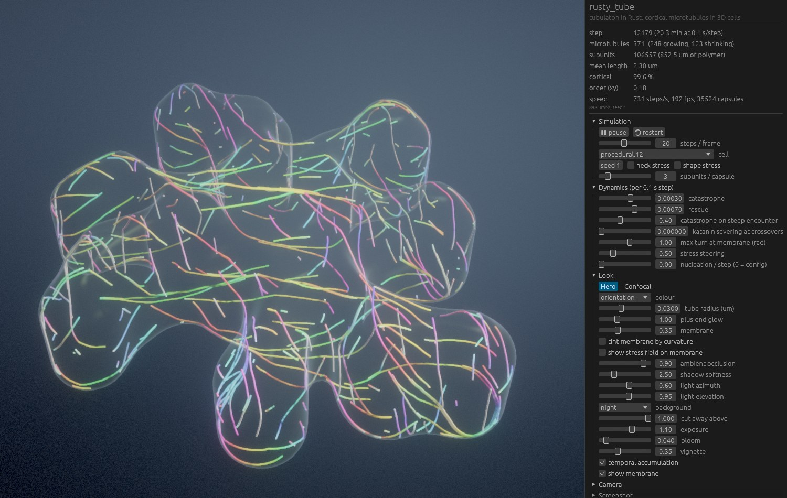
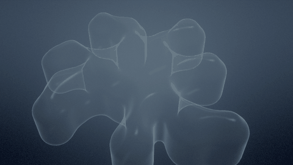
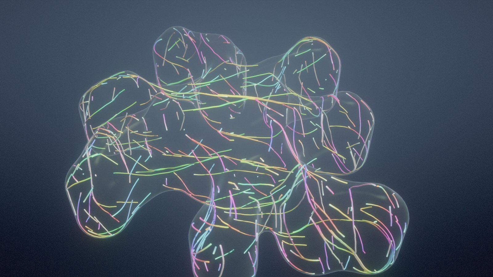
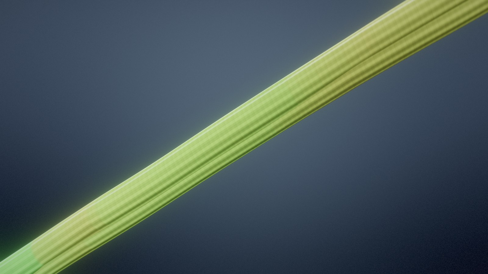
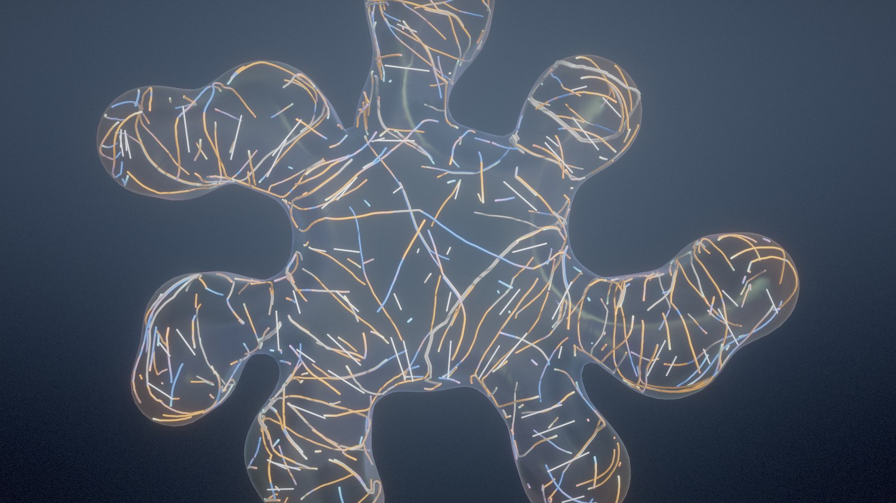
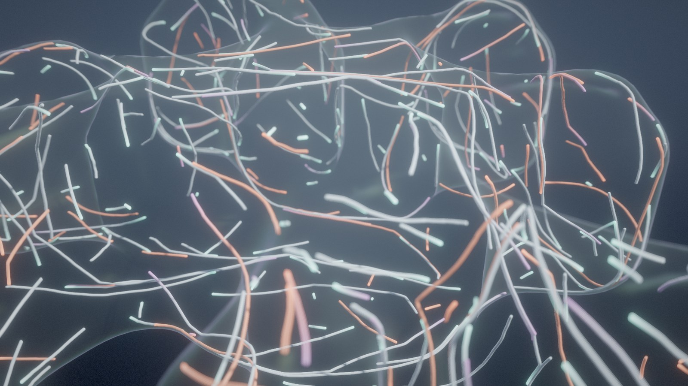
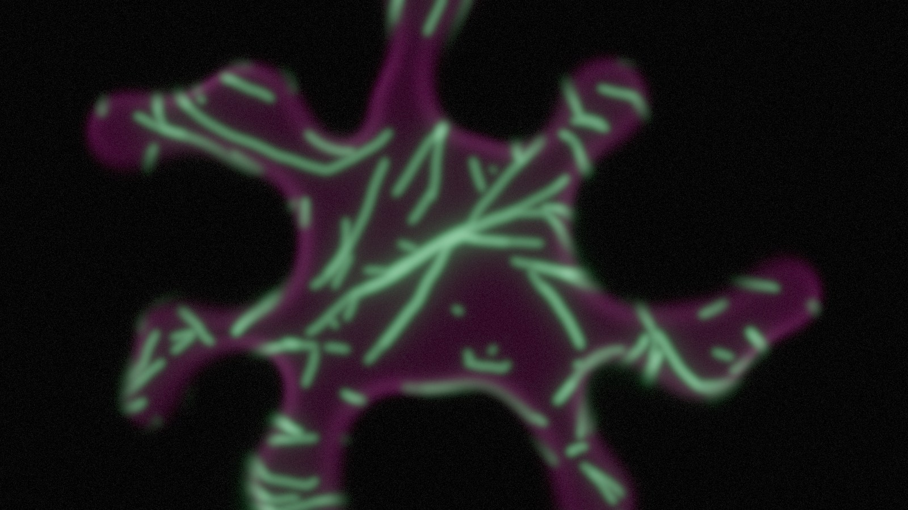
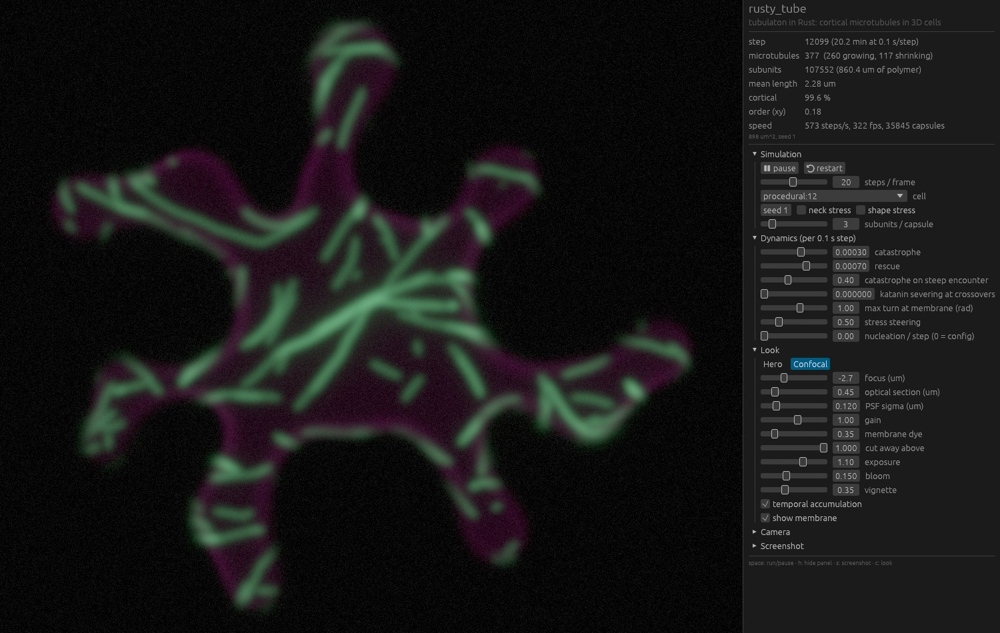

# rusty_tube

A Rust port of [tubulaton](https://doi.org/10.1371/journal.pcbi.1006011)
(Mirabet et al. 2018), the 3D simulator of cortical microtubule
self-organisation, with pavement-cell geometry generation and a real-time
renderer.

* **The port** reproduces the C++ statistically (24-seed comparison in
  [PORTING.md](PORTING.md)) and runs about 35× faster. It reads the same
  `.ini` configs and writes the same report and binary VTK files.
* **Geometry**: closed 3D pavement cells built from a 2D outline (segmented
  imaging, the pavesim tissue model, or procedural), as a rounded extrusion
  whose outer face domes like an inflated membrane, meshed by surface nets
  with exact normals.
* **Stress fields**: an imposed neck field, or a shape-derived field from an
  inflated-membrane model whose magnitude is the local stress anisotropy.
* **Rendering**: real-time and offline, in two looks (see below).



<p align="center"></p>

## Gallery

All images are of generated cells (`--outline procedural:12`), rendered
with `rusty_tube render`.

| | |
|---|---|
|  |  |
| **Hero look**, colour = filament orientation in the leaf plane, thin-lens depth of field | **Close-up** at true 25 nm diameter: 13 protofilaments and the 8 nm dimer lattice |
|  |  |
| **Stress alignment** (`--shape-stress --preset stress`): glyphs show the principal stress axis (length ∝ anisotropy); orange filaments lie along it, blue across | **Dynamics**: growing filaments pale with glowing EB1-like plus-end comets, shrinking ones red |
|  |  |
| **Confocal look**: GFP-tubulin and a membrane dye in an optical section through the outer face | **The viewer** in the confocal look |

## Quick start

```sh
cargo run --release -- view                       # interactive
cargo run --release -- view --outline procedural:12 --preset dense --warmup 12000
cargo run --release -- render --outline procedural:7 --steps 12000 --out out/cell.png
cargo run --release -- render --outline procedural:7 --shape-stress --preset stress \
    --steps 1 --frames 480 --every 25 --orbit 0.3 --colour 4 -r stress_tint=1 \
    --out out/stress.mp4                          # time-lapse (needs ffmpeg, or set FFMPEG)
cargo run --release -- run tubulaton_config.ini   # headless, C++-compatible output
cargo run --release -- mesh --outline cell.csv --out cell.vtk --neck-stress
```

`--outline` takes a CSV of x,y in µm, a pavesim JSON with an `outline`, or
`procedural:SEED`: a generated pavement cell, a central body with six to
nine curving arms pinched into necks and swelling into lobes, some
branching. Real outlines can be exported from pavesim's leaf
segmentations into `cells/real/`, which is git-ignored because that imaging
is unpublished.

Viewer keys: drag to orbit, right-drag to pan, scroll to zoom, `space` to
run or pause, `h` to hide the panel, `s` for a screenshot (rendered offscreen
at up to 4× with up to 1024 samples), `c` to switch look.

## Parameter presets

| preset | what it is |
|---|---|
| `calibrated` (default) | pavesim's calibration: 1 step = 0.1 s at 0.08 µm/s growth, measured catastrophe, rescue and nucleation rates |
| `dense` | illustrative: catastrophe on 40 % of steep encounters (Dixit & Cyr 2004), a 57° membrane turn limit instead of 40°, and no self-encounters (`self_encounters=0`, see below). In lobed cells the 40° rule causes most catastrophes, so this array is about 3× denser |
| `stress` | `dense` plus steering by the stress field, with weight proportional to the local field magnitude (`part_influence_influence=0.005`, `influence_ref=1`) |
| `cellulose` | `dense` plus cellulose synthase complexes, with microtubule rescue at 0.03 /s, set from the measured chance co-localisation (see below) |

## Self-encounters

tubulaton's neighbour search excludes only a filament's own last ten
subunits, so a growing tip can meet and bundle with older parts of its own
filament. If it meets them anti-parallel, the bundling rule turns it back
along itself: a hairpin that then follows itself into a coil. A microtubule,
with a persistence length of millimetres, cannot curve back on itself on this
scale; the hairpins come from membrane guidance carrying the tip round a
lobe end. `self_encounters=0` excludes a filament's own lattice from the
search. The default (1) keeps tubulaton's behaviour, where it is a small
effect: about 5 000 self-contact growth steps in 15 000 steps of the
calibrated set on a real cell, against about 300 000 with the gentler
membrane limit of `dense`, which is why both illustrative presets switch it
off.

## Cellulose synthase and cellulose (experimental)

`-s csc_enable=1` adds cellulose synthase complexes (CSCs) in the plasma
membrane and the cellulose they deposit (`src/sim/csc.rs`). Not part of
tubulaton.

* **Insertion** at a per-area rate, preferentially next to cortical
  microtubules, then a pause.
* **Movement** at constant speed. A complex tethered by CSI1 follows its own
  microtubule, through crossovers, until that microtubule depolymerises
  from under it. An untethered one runs straight, nudged toward the
  cellulose already in the wall (the autonomous guidance of Chan & Coen
  2020). A free complex can be captured by a nearby microtubule that runs
  close to its heading.
* **Removal** after an exponential lifetime.
* **Deposition**: each complex extrudes a microfibril behind it. The wall
  keeps, per membrane vertex, a nematic orientation tensor, the amount of
  cellulose, and the fraction that has crystallised.
* **Mutant**: `csc_tether=0` is the *csi1* mutant.

| parameter | value | basis |
|---|---|---|
| CSC speed | 0.35 µm/min | measured: 353 ± 79 nm/min (Paredez et al. 2006) |
| lifetime in the membrane | 7 min | measured (Sampathkumar et al. 2013) |
| density | 1 per µm² at steady state | measured (Sampathkumar et al. 2013); sets insertion = density / lifetime |
| pause after insertion | 1 min | measured (Gutierrez et al. 2009) |
| insertion next to microtubules | 80 % with CSI1, none without | **assumed** value: "preferentially" in Gutierrez et al. 2009; lost in *csi1* (Zhu et al. 2023) |
| guidance update interval | 5 s | numerical: a complex moves about 30 nm in that time |
| capture distance / angle | 0.1 µm / 40° | **assumed** |
| autonomous (fibril) guidance | 0.2 | **assumed**; qualitative in Chan & Coen 2020 |
| crystallisation time | 30 min | **assumed**: there is no kinetic model of primary-wall crystallinity; treat it as a placeholder to compare with bulk measurements |

### Validation against Li et al. 2012

Li et al. 2012 counted CESA particles co-aligned with microtubules in
wild type and *csi1*, and the level expected by chance. The chance level
depends only on how much microtubule there is, so it is used to set the one
free microtubule parameter. Microtubule rescue goes to 0.03 /s, inside the
measured range of about 0.007–0.08 /s (the calibrated set uses 0.007 /s).
That gives a chance level of 43 %, as measured. Co-localisation in wild type
and *csi1* is then a prediction (`--preset cellulose`; `cargo run --release
--example csc_stats -- proba_rescue=0.003`, 40 min, 3 seeds):

| | model | measured |
|---|---|---|
| chance level (fitted) | 43.3 ± 0.6 % | 43 ± 6 % |
| wild type | 63.7 ± 1.2 % | 73 ± 4 % |
| *csi1* | 43.7 ± 0.6 % | 47 ± 11 % |

*csi1* matches, and so does its mechanism. CSI1 is also needed to deliver
complexes to microtubules: in *csi1* the microtubule-associated delivery
compartments are rarely seen (Zhu et al. 2023). So in the model *csi1* loses
both the tether and the insertion bias. Wild type is within 2 SD of the
measurement but about 9 points low. The model also predicts that wall
cellulose follows the microtubules in wild type but not in *csi1*:
orientation agreement 0.81 vs 0.49, where 0.5 is chance.

With the calibrated rescue rate the array is too sparse for this
comparison: chance 36 %, wild type 45 %.

Rendering: complexes are glowing beads, dim while paused. Microfibrils are
thin tubes, teal when new and warm white when crystalline. In the confocal
look they appear as CESA puncta (orange) and a cellulose stain (blue).
Viewer and `-r` switches: `show_cscs`, `show_fibrils`, `show_mts`.

The complexes do not yet act back on the microtubules or on wall
mechanics. Those are the next steps.

## Stress-dependent alignment

`--shape-stress` derives a stress field from the cell outline by treating
the outer periclinal face as a flat membrane inflated by turgor. It solves
the Prandtl problem ∇²u = −1 inside the outline and takes the principal axes
of the Hessian of u. A round lobe is isotropic, and a narrow neck or arm is
fully anisotropic with the larger stress across it, as hoop stress exceeds
axial stress in a pressurised cylinder. The field written to `strain_0` has
magnitude equal to the anisotropy |λ₁−λ₂|/(|λ₁|+|λ₂|). On the anticlinal wall
it turns vertical, so a neck's stress runs over the face and down the wall
like a hoop. This is a shape-based proxy, not a mechanical simulation.

tubulaton steers cortical filaments toward `strain_0`, and with
`influence_ref` > 0 the steering weight scales with the field's magnitude.
With the `stress` preset on a real pavement cell (12 000 steps), the mean cos²
between cortical subunits and the stress axis rises with anisotropy:

| local anisotropy | 0–0.25 | 0.25–0.5 | 0.5–0.75 | 0.75–1 |
|---|---|---|---|---|
| no coupling | 0.51 | 0.55 | 0.51 | 0.48 |
| `stress` preset | 0.56 | 0.67 | 0.75 | 0.84 |

(0.5 is random in the plane; `cargo run --release --example stress_align`.)

## Rendering

**Hero look** (deferred, HDR):

* Microtubules are ray-traced capsule impostors: each segment's bounding box
  is rasterised, and the fragment shader intersects the exact capsule and
  writes true depth. Tubes are round at any zoom and join seamlessly.
* Molecular detail fades in as you zoom: 13 protofilaments and the 8 nm
  α/β-tubulin lattice with its 3-start helical offset, kept in proportion
  when the tube radius is exaggerated.
* Soft shadows from a 2048² shadow map of the impostors, sampled with a
  rotated Poisson disk.
* Normal-oriented hemisphere SSAO.
* GGX specular, a wrapped diffuse for thin tubes, rim light, and
  aerial-perspective fog.
* EB1-like comets on growing plus ends and a hot glow on shrinking ones.
* The membrane is a two-sided translucent shell with Fresnel opacity, a
  faint thin-film sheen and received shadows. It can be tinted by outline
  curvature or by stress anisotropy, and cut away at any height.
* Colour by nematic orientation, dynamics, filament, age, or alignment with
  the stress field.
* Stress glyphs on the outer face show the principal axis, with length ∝
  anisotropy.

**Confocal look**: every subunit is splatted through a Gaussian PSF and
weighted by an optical section you can focus through the cell, with defocus
widening the spot. A membrane dye seen through the same section shows the
cell outline.

**Both looks**:

* Temporal anti-aliasing (Halton jitter, reprojection, YCoCg neighbourhood
  clamp) while things move.
* Progressive supersampling when the scene is still.
* Physically based bloom (13-tap downsample with a Karis average, tent
  upsample).
* AgX tone mapping, vignette and film grain.
* Thin-lens depth of field, integrated over the aperture by the
  accumulation.

## Layout

```
src/params.rs      tubulaton's Parameters (keys, aliases, Update blocks, rate calibration)
src/sim/           the dynamics: elements, microtubules, membrane, spatial grids, output
src/cellgen.rs     outlines -> 3D cells; neck and shape-derived stress fields
src/mesh.rs, vtk.rs  surfaces and legacy VTK I/O
src/render/        renderer, WGSL shaders, camera, offline PNG/MP4 output
src/viewer.rs      winit + egui viewer; the simulation runs on its own thread
tests/regression.rs  statistical check against the C++
```
